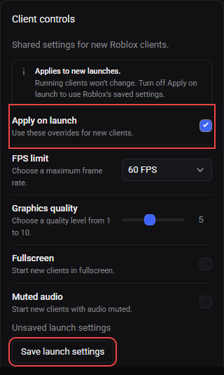

# Client controls

Open **Instances** and find **Client controls**. These are shared defaults for future RM launches, not settings for the selected running client. Selecting a client shows its identity but does not make these overrides account-specific.

*Demo screenshot. The red boxes identify the enable switch and save action; the example has an unsaved edit.*

## Save launch overrides

1. Turn on **Apply on launch**.
2. Leave **Only RM launches** on to keep website and standalone Roblox app launches on Roblox's normal settings. This option appears when **Apply on launch** is on and defaults to on, including for existing RM preferences. Turn it off to apply overrides to Roblox's shared settings file instead.
3. Choose the desired values below.
4. Choose **Save launch settings**. Saving is unavailable when nothing has changed or a request is pending.
5. Launch new clients through RM to use the saved settings.

| Control | Available values |
| --- | --- |
| FPS limit | 30, 60, 120, 144 or 240 FPS |
| Graphics quality | 1–10 |
| Fullscreen | On or off |
| Muted audio | On or off |

Saving does not update clients already running. An FPS limit is a target ceiling, not a promise that your hardware will achieve that frame rate.

## Disable overrides

Turn off **Apply on launch** and save. RM stops reapplying these overrides; Roblox keeps its last saved local settings. Disabling the switch does not restore an earlier Roblox configuration or change a running client's settings.

These preferences are stored separately from account credentials in `client-launch-settings.json` beside RM's configuration. With **Only RM launches** on, RM copies Roblox's normal settings, applies the overrides to `roblox-client-settings.xml` beside RM's configuration, and passes that file to the player through `--globalBasicSettingsPath`. This covers game and Home launches through RM and leaves Roblox's normal settings file untouched. This relies on the installed player honoring that launch argument; Roblox updates may change support.

With **Only RM launches** off, RM updates Roblox's local `GlobalBasicSettings_13.xml` before each RM launch. Website and standalone app launches can then inherit those saved values. Switching back to RM-only mode does not undo values previously written to the shared file; adjust Roblox's normal settings if needed. Custom arguments cannot override RM's settings-file selection with `-g` or `--globalBasicSettingsPath`.

In shared mode, if Roblox's XML has the Windows read-only attribute, RM temporarily clears it for the atomic update and restores it afterward, including when the write fails. The usual `.bak` backup is retained. RM does not change Windows access-control lists or bypass locks held by another program; those failures still stop the launch. RM-only mode only reads the normal file, preserving its contents, attributes and backup.

After saving the new option, older RM versions cannot read these launch preferences because they reject unknown fields. Their **Reset launch settings** action restores compatible defaults. Account credentials are unaffected.

## Retry a failure

If the controls cannot load, use **Retry**. **Reset launch settings** restores RM's launch preferences to their defaults; it is not an account-store reset. If applying preferences fails before launch, correct the reported Roblox settings/file problem before retrying.

For window tiling, launch pacing and custom arguments/FastFlags, see [Settings](settings.md). For process attribution and closing clients, see [Running instances](instances.md).
